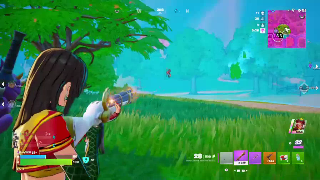
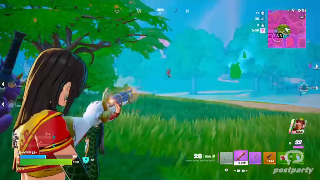

# Postparty Outro Trimmer

A tiny single-page web app that removes the Postparty outro animation from the end of a clip and adds a small, semi-transparent Postparty logo in the bottom-right corner, so the creators still get credit.

Everything runs **in your browser**. Your clip is never uploaded anywhere. The only network request the page makes is a one-time download of the video encoder (see [How it works](#how-it-works)), which your browser then caches.

- **Live:** https://codymkw.github.io/postparty-trimmer
- **Original release** (more options, optional watermark): https://codymkw.github.io/postparty-trimmer/original-release
- **Clip editor** (trim + stickers): https://codymkw.github.io/postparty-trimmer/editor

> Unofficial fan tool. Not affiliated with or endorsed by Postparty or Epic Games.

---

## Two versions

| | Main version (this page) | [Original release](original-release) |
| --- | --- | --- |
| Link | https://codymkw.github.io/postparty-trimmer | https://codymkw.github.io/postparty-trimmer/original-release |
| Removes the outro | Always | Always |
| Postparty logo watermark | **Always on** (Subtle by default) | Optional checkbox, off by default |
| "Clipped in Postparty" tag | Not written | Optional checkbox, on by default |
| Best for | Making sure Postparty still gets credit | Wanting the outro gone without a watermark, or a hidden tag only |

The main version is the more professional one: the outro is gone, and Postparty is still credited because the logo is part of the picture, so it survives re-uploads to Discord, YouTube and similar sites. See [Original release](#original-release) for the version with the extra options.

Looking for more than an outro trim? There's also a separate [Clip editor](#clip-editor) with a trim timeline and resizable, rotatable stickers.

---

## What it does

1. **Drop in a clip** (MP4 recommended).
2. The page **scans the end of the clip** and finds the exact frame where the Postparty outro card starts.
3. It shows you the **last frame kept** and the **first frame removed** so you can check the cut. You can nudge the cut point if it's off.
4. Click **Trim & export**. You get a new MP4 with the outro gone and the Postparty logo in the bottom-right corner.

Settings in the Export section:

| Setting | Default | What it does |
| --- | --- | --- |
| Opacity | Subtle (35%) | How see-through the logo is: Subtle (35%), Normal (55%) or Bold (80%). |
| Quality | Balanced | Re-encode quality (see [Quality presets](#quality-presets)). |

---

## Samples

The same clip, three ways. Click a thumbnail to watch the video. The files live in the [`videos/`](videos) folder.

| 1. Original | 2. Outro removed | 3. Outro removed + logo |
| :---: | :---: | :---: |
| [](https://codymkw.github.io/postparty-trimmer/videos/clip_with_outro.mp4) | [](https://codymkw.github.io/postparty-trimmer/videos/clip_without_outro.mp4) | [](https://codymkw.github.io/postparty-trimmer/videos/clip_with_logo_bottom_right.mp4) |
| The clip as exported from Postparty, with the outro animation at the end. | The outro is gone and the clip ends on the last frame of gameplay. (The original release can export this with no watermark.) | Same as #2, plus the semi-transparent Postparty logo in the bottom-right corner. This is what the main version does. |

---

## The Postparty logo watermark

The logo goes in the bottom-right corner of every export from the main version, so the creators of Postparty still get credit even though their outro is gone.

- The logo is drawn **see-through** (the logo itself is transparent, not just its background), so you can see the video through it.
- **Opacity** dropdown: Subtle (35%, default), Normal (55%), Bold (80%).
- Size is **13% of the video width**, placed in the bottom-right with a margin of 2% of the video height.
- A faint dark shadow is added so the white logo stays readable on bright scenes.
- The logo is a white WebP with a transparent background, embedded in `index.html` as a base64 data URI (`LOGO_DATA_URI`). To swap it, replace that string.
- The Postparty logo belongs to Postparty. It's included here only so people can credit them.

---

## Original release

The first version of this tool lives in the [`original-release/`](original-release) folder and is live at https://codymkw.github.io/postparty-trimmer/original-release. It has two extra options in the Export section:

| Option | Default | What it does |
| --- | --- | --- |
| "Clipped in Postparty" tag | On | Writes invisible metadata into the MP4 saying the clip was clipped in Postparty. Doesn't change the picture or sound. |
| Postparty logo watermark | Off | Burns the same small, semi-transparent Postparty logo into the bottom-right corner. Opacity defaults to Normal (55%). |

### The watermark there is totally optional

In the original release the watermark is **completely optional**. It's off by default, and you don't have to use it. The outro is gone either way.

But if you'd still like to give credit to Postparty (since the outro was their little advertisement), you can tick **Add the Postparty logo as a small watermark**, and a semi-transparent logo goes in the bottom-right corner of your clip. That way the creators still get a bit of exposure, lol.

### The "clipped in Postparty" tag (original release only)

When enabled, these tags are written into the MP4:

| Key | Example | Meaning |
| --- | --- | --- |
| `postparty_clipped` | `true` | The marker. |
| `postparty_trimmed_at` | `29.445` | Where the clip was cut, in seconds. |
| `postparty_original_duration` | `34.441` | Length of the clip before trimming, in seconds. |
| `comment` | `Clipped in Postparty (outro removed)` | Shows up in places like Windows file Details. |

Check a file for the tag with:

```bash
ffprobe -v error -show_entries format_tags -of default=nw=1 clip-trimmed.mp4
```

You'll see `TAG:postparty_clipped=true` and the others. The original release's page also shows the tags after export, and when you drop a file that already has the marker it tells you so (it looks for the text `postparty_clipped` in the first and last 4 MB of the file).

What the tag is and isn't:

- It **doesn't** change the picture or sound.
- It **doesn't survive** most platforms. Discord, YouTube, Twitter/X and others re-encode uploads and drop custom tags, so it only lasts if people share the raw file.
- It's **not proof** of anything. Anyone can write the same tag onto any video. (Making it verifiable would need something like a signed hash, which this project doesn't do.)

If you want credit that does survive re-uploads, use the watermark. That's why the main version always adds it.

---

## Clip editor

Live at https://codymkw.github.io/postparty-trimmer/editor

A fuller editor for Postparty clips: trim the video, then decorate it with PNG stickers you can drag, resize and rotate right on the video. Like the other pages, everything runs in your browser and nothing is uploaded.

Unlike the two trimmer pages, the editor does **not** add the Postparty logo automatically. The logo is in the sticker library though, so you can place it yourself wherever you like.

### What you can do

- **Trim.** A filmstrip timeline with draggable start and end handles, a playhead you can scrub, and a looping preview of the trimmed section. When a clip loads, the editor looks for the Postparty outro and trims it off for you. **Remove Postparty outro** runs that detection again and **Reset trim** puts the whole clip back. (It uses the same detector described in [Finding the outro](#1-finding-the-outro).)
- **Add stickers.** Click a sticker in the library to put it on the video, then:
  - drag it to **move** it,
  - drag the square handle at the bottom-right corner to **resize** it (the shape stays the same),
  - drag the round handle above it to **rotate** it (hold **Shift** to snap to 15°).
- **Fine-tune in the side panel.** Size (2% to 150% of the video width), rotation (−180° to 180°), opacity (10% to 100%), flip, bring forward / send back (layer order), duplicate and delete.
- **Limit a sticker to part of the clip.** Tick **Only show during a time range** and set From and To in seconds (on the original clip's timeline, the same one the timeline shows). **From = playhead** and **To = playhead** fill the numbers in for you. A sticker outside its range is hidden in the preview, and shown faded while it's selected so you can still edit it.
- **Use your own images.** Click **+ Add your own images**, drop an image anywhere on the page, or paste one from the clipboard (PNG with transparency works best). Your images are added to the library for the session and placed on the video straight away. Hover one and click the **×** to remove it from the library. They aren't saved, so they're gone when you reload the page.
- **Export.** Pick a quality (the same Near-lossless / Balanced / Smaller presets as above) and optionally tick **Remove audio**, then click **Export video**.

### Default stickers

The library comes with 12 stickers built into the page: Duck, Ankha, Shrek, Cat girl, Heart hug, Crying, R.I.P., Sleepy dragon, three Mii faces (sunglasses, green hair, glasses) and the Postparty logo. They're stored in `editor/index.html` as lossless WebP data URIs in the `DEFAULT_STICKERS` list near the top of the script. Each entry looks like this:

```js
{ "id": "duck", "label": "Duck", "src": "data:image/webp;base64,..." }
```

To add or remove a default sticker, add or delete an entry. `label` is the hover text. Transparent images work best, and cropping away empty margins keeps the selection box snug around the picture.

### Keyboard shortcuts

| Key | What it does |
| --- | --- |
| `Space` | Play / pause |
| `I` | Set the trim start to the playhead |
| `O` | Set the trim end to the playhead |
| `Delete` / `Backspace` | Remove the selected sticker |
| Arrow keys | Nudge the selected sticker (hold `Shift` for bigger steps). With nothing selected: step the playhead by one frame (about 1/30 s), or 1 s with `Shift` |
| `Esc` | Deselect |
| `Ctrl`/`Cmd` + `V` | Paste an image from the clipboard as a new sticker |

### How the editor exports

Everything you see in the preview is burned into the exported video:

1. Each sticker is drawn onto a transparent PNG at its **final pixel size** (scaled, rotated, flipped and faded exactly as shown), with a canvas in your browser. The PNG covers the sticker's rotated bounding box.
2. The clip and the sticker PNGs go into ffmpeg's in-memory filesystem, and ffmpeg overlays them one after another in layer order.
3. Stickers with a time range get an `enable` condition so they only appear during that range.

The command looks like this (the `-i st*.png` inputs and the filter chain repeat once per sticker; with no stickers it's just `-map 0:v:0`, and **Remove audio** swaps the audio options for `-an`):

```bash
ffmpeg -ss <start> -i in.mp4 \
       -i st0.png -i st1.png \
       -t <length> \
       -filter_complex "[0:v:0][1:v]overlay=x=X0:y=Y0:format=auto[v1];\
                        [v1][2:v]overlay=x=X1:y=Y1:format=auto:enable='between(t,A,B)'[v2];\
                        [v2]format=yuv420p[vout]" \
       -map "[vout]" -map 0:a? \
       -c:v libx264 -preset veryfast -crf <16|21|26> -pix_fmt yuv420p \
       -c:a copy \                                  # falls back to: -c:a aac -b:a 192k
       -movflags +faststart \
       out.mp4
```

Details:

- `-ss <start>` before `-i` makes the trim frame-accurate because the video is re-encoded anyway. `-t <length>` is the trimmed length.
- `X` and `Y` are the top-left of the sticker's bounding box in video pixels, so stickers can hang off the edge of the frame and get clipped, just like in the preview.
- `A` and `B` are the From and To times **minus the trim start**, because the exported clip's time starts at 0.
- Sticker positions and sizes are stored as fractions of the video frame, so the preview matches the export no matter how big the preview is on your screen.
- A sticker whose time range is completely outside the trimmed section is left out of the export.

The editor reuses the same ffmpeg.wasm setup as the trimmer (see [Cutting and encoding](#2-cutting-and-encoding)). In headless Chromium, trimming a ~29 s 896×504 clip with two stickers took about 46 seconds.

### Editor constants

At the top of the editor's script:

| Constant | Value | Meaning |
| --- | --- | --- |
| `SCAN_LOOKBACK_S` | `30` | How far back from the end to look for the outro. |
| `SCAN_STEP_S` | `0.25` | Coarse step while walking backwards through the outro. |
| `CUT_SAFETY_S` | `0.005` | How far before the first outro frame to cut. |
| `MIN_CLIP_S` | `0.1` | Shortest trimmed section the handles allow, in seconds. |
| `FILM_FRAMES` | `16` | Thumbnails in the timeline filmstrip. |
| `CDN_CORE` | `@ffmpeg/core@0.12.10` on jsDelivr | Where the encoder is downloaded from. |

### Good to know

- Small stickers that are scaled up a lot (for example a 112 px image on a 1080p clip) will look soft. Bigger source images stay sharper.
- Sticker times and the trim both work in the original clip's timeline.
- Rotated phone videos (rotation metadata) aren't handled specially, same as the trimmer.
- The preview uses your browser's own video decoder, so the clip has to be something your browser can play (H.264 MP4 is the safe choice).
- It was built and tested in Chromium with real mouse drags for moving, resizing and rotating, and the exported frames were checked against where the stickers were placed. Touch dragging on a real phone hasn't been tested.

---

## Using it

### Online
Use the live page at https://codymkw.github.io/postparty-trimmer, or host `index.html` yourself anywhere that serves static files (GitHub Pages, Nekoweb, Cloudflare Pages, etc.). There is nothing to build and no server code.

To host it on GitHub Pages: put `index.html` in the repo root, then go to **Settings → Pages** and publish from the `main` branch (root folder). The original release and the clip editor are picked up automatically from the `original-release/` and `editor/` folders.

### Locally
Serve the folder over HTTP instead of opening the file directly:

```bash
python3 -m http.server 8000
# main version:      http://localhost:8000/
# original release:  http://localhost:8000/original-release/
# clip editor:       http://localhost:8000/editor/
```

No special headers are needed (no COOP/COEP), because the page uses the single-threaded encoder.

### Requirements
- A modern desktop browser. It was built and tested in Chromium (Chrome/Edge). Firefox and Safari should work but haven't been tested, and neither has mobile.
- The browser must be able to **play** the clip, because detection and the preview use the browser's own decoder. H.264 MP4 is the safe choice.
- An internet connection the first time, to download the encoder (about 31 MB). After that it's cached.

---

## Repo layout

```
.
├── index.html            # main version: always trims + always adds the logo (Subtle by default)
├── README.md
├── editor/
│   └── index.html        # clip editor: trim + draggable, resizable, rotatable stickers
├── original-release/
│   └── index.html        # original version: optional tag, optional watermark
└── videos/               # sample clips + thumbnails shown in the README (not used by the apps)
    ├── clip_with_outro.mp4
    ├── clip_with_outro.jpg
    ├── clip_without_outro.mp4
    ├── clip_without_outro.jpg
    ├── clip_with_logo_bottom_right.mp4
    └── clip_with_logo_bottom_right.jpg
```

Each HTML file is the entire app: HTML + CSS + JS, with its images embedded.

---

## How it works

### 1. Finding the outro

The Postparty outro is a card with a flat, near-black, neutral background (about `RGB(18,18,18)` in the clip it was built from), and the gameplay before it never looks like that. The detector uses that:

1. Seek a hidden `<video>` to the last frame and draw it to a small 96×54 canvas.
2. Take four **8×5 corner patches** (one per corner) and average each.
3. If the last frame isn't **flat dark** (every corner has max channel ≤ 60 and channel spread ≤ 14), report "no outro found" and let you pick the cut manually.
4. Otherwise, walk **backwards in 0.25 s steps** while the corners still match the last frame (each channel within ±16).
5. When a step stops matching, **binary-search** between the last matching and first non-matching time (10 iterations, about 0.25 ms precision) to find the first outro frame.
6. The cut is placed **5 ms before** that frame so the last gameplay frame is kept and the first outro frame is dropped.

On the sample clip this found the outro at 29.450 s, which is the true first outro frame.

Tunable constants are at the top of the script and the detection section:

| Constant | Value | Meaning |
| --- | --- | --- |
| `SCAN_LOOKBACK_S` | `30` | How far back from the end to look for the outro. If the outro card runs longer than this, detection gives up and you set the cut by hand. |
| `SCAN_STEP_S` | `0.25` | Coarse step size while walking backwards. |
| `CUT_SAFETY_S` | `0.005` | How far before the first outro frame to cut. |
| `CDN.core` | `@ffmpeg/core@0.12.10` on jsDelivr | Where the encoder is downloaded from. |
| `MARKER_KEY` | `postparty_clipped` | Original release only: metadata key written to, and searched for in, files. |
| `MARKER_COMMENT` | `Clipped in Postparty (outro removed)` | Original release only: human-readable Comment tag. |

If the outro changes (different background colour or a new design), the thresholds in `flatDark()` and `matches()` are what to adjust. The manual slider always works as a fallback.

### 2. Cutting and encoding

The page uses the **ffmpeg.wasm core** (`@ffmpeg/core`), which is real ffmpeg compiled to WebAssembly. It is loaded through a small custom Web Worker created from a blob, rather than through `@ffmpeg/ffmpeg`, because that package's own worker can't be started from a CDN.

The command the main version runs looks like this:

```bash
ffmpeg -i in.mp4 \
       -i wm.png \
       -t <cut> \
       -filter_complex "[0:v:0][1:v]overlay=x=W-w-M:y=H-h-M:format=auto,format=yuv420p[v]" \
       -map "[v]" -map 0:a? \
       -map_metadata 0 \
       -c:v libx264 -preset veryfast -crf <16|21|26> -pix_fmt yuv420p \
       -c:a copy \                                   # falls back to: -c:a aac -b:a 192k
       -movflags +faststart \
       out.mp4
```

The original release builds the same command, with two differences depending on its checkboxes: without the watermark box ticked it leaves out the second input and the filter (`-map 0:v:0 -map 0:a?` instead of `-map "[v]" -map 0:a?`), and with the tag box ticked it uses `-movflags +faststart+use_metadata_tags` and appends:

```bash
-metadata postparty_clipped=true \
-metadata postparty_trimmed_at=<cut> \
-metadata postparty_original_duration=<duration> \
-metadata "comment=Clipped in Postparty (outro removed)"
```

Flag notes:

- `-t <cut>`: keep only the first `<cut>` seconds.
- `-map 0:a?`: include audio if there is any.
- `-map_metadata 0`: keep the original file's metadata.
- `-c:a copy`: audio is copied untouched. If the source audio can't be put into an MP4, the page retries with AAC at 192 kbps.
- `-movflags +faststart`: puts the index at the start of the file so it plays/streams quickly.
- `-movflags use_metadata_tags` (original release only): lets ffmpeg write custom keys such as `postparty_clipped` (without it MP4 only keeps a few standard keys).
- `M` in the overlay is 2% of the video height.

**Why the video is re-encoded instead of stream-copied:** a lossless `-c copy` cut only works cleanly if the cut lands on a keyframe boundary. In the sample clip the encoder didn't put a keyframe at the outro boundary, and the first outro frame is stored *ahead of* the last gameplay frames. Copying left outro frames in the file. Re-encoding gives a frame-exact cut every time.

### Quality presets

| Preset | CRF | Notes |
| --- | --- | --- |
| Near-lossless | 16 | Biggest file. |
| Balanced (default) | 21 | On the sample clip, the 29 s output was about 10.4 MB, a bit smaller than the 11.3 MB, 34 s original. |
| Smaller file | 26 | Smallest file, visibly softer. |

Lower CRF means higher quality and a larger file.

### 3. The watermark image

The logo is decoded by the browser, drawn on a canvas at the chosen opacity (with a soft shadow), exported as a PNG, written into ffmpeg's in-memory filesystem as `wm.png`, and overlaid with ffmpeg's `overlay` filter. This avoids needing any font files inside ffmpeg.

---

## Limitations and troubleshooting

- **Speed:** encoding is single-threaded WebAssembly, so it's slower than desktop ffmpeg. In headless Chromium, a ~29 s 896×504 clip took roughly 40 to 65 seconds. Longer or higher-resolution clips take proportionally longer.
- **Memory:** the whole clip is loaded into memory to process it. Clips of a few hundred MB or less work best.
- **"Your browser can't play this file":** detection and preview rely on the browser's decoder. Try an H.264 MP4 (HEVC/H.265 often won't play in browsers).
- **"Couldn't find an outro":** the last frame didn't look like the outro card, or the card runs longer than `SCAN_LOOKBACK_S`. Drag the slider, use "Set to player position", or adjust the thresholds above.
- **Cut is a frame off:** use the −0.1 s / +0.1 s buttons or type an exact time, and check the two preview frames.
- **Export fails or the encoder won't load:** check your connection (the encoder comes from jsDelivr), disable extensions that block blob workers, and look at the browser console. A failed load can be retried by clicking export again.
- **Rotated phone videos:** rotation metadata isn't handled specially. This tool is aimed at landscape game clips.

---

## Credits

- Video processing by [ffmpeg.wasm](https://github.com/ffmpegwasm/ffmpeg.wasm) (`@ffmpeg/core`), which bundles ffmpeg and x264 under their own licenses.
- The default stickers in the clip editor are fan images of characters from games, shows and other media, and belong to their respective creators. They are included only as fun stickers.
- The Postparty name and logo belong to Postparty. This project isn't affiliated with them, it just tries to keep some credit flowing their way.
